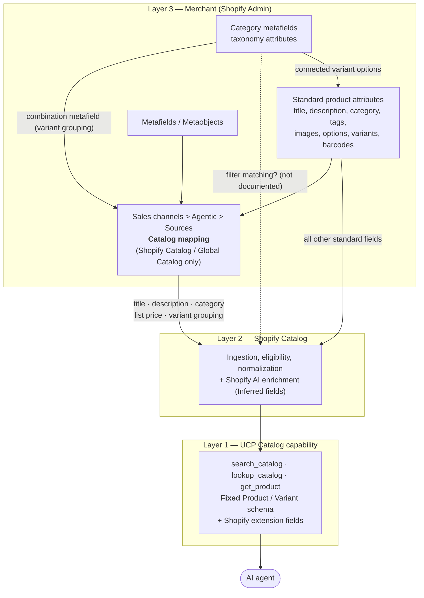
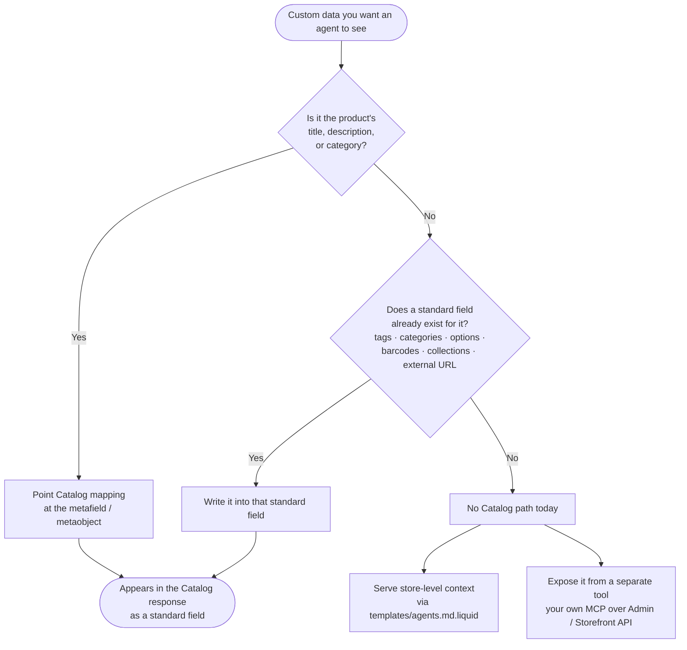
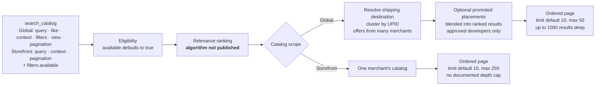
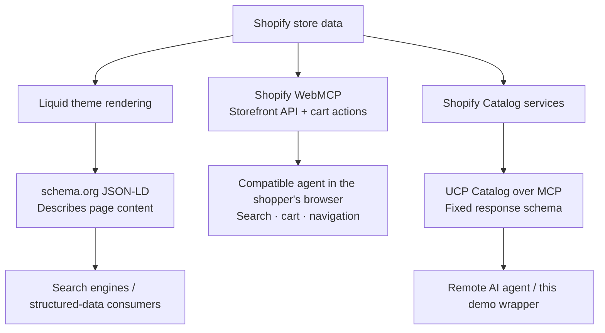

# Shopify Catalog Field Mapping & Data Sources

How merchant product data becomes a UCP Catalog response, how far custom data can travel, how keyword search results are ordered, and which parts of all this Shopify publishes.

This guide combines public sources—UCP and Shopify documentation, Shopify's developer community and official theme repositories, and Google Search documentation—with dated maintainer-reported tests. Sources are linked inline and collected in [References](#references); observations are labeled separately.

> **Verified:** 2026-10-29 · **UCP version:** `2026-08-25`
> Parts of this area (promoted placements) are in Developer Preview, and Shopify states that endpoint URLs and field shapes can change. Re-check the linked pages before relying on a detail.
>
> Global Catalog and Storefront Catalog differ in more than scope. Where a behaviour applies to only one of them, this document says so; do not carry a Global Catalog limit over to Storefront Catalog or the other way round.
> Dated demo-store observations below were supplied by the maintainer for this revision. They are not platform guarantees or live tests re-run for this documentation update.

---

## 1. The three layers

A Catalog field is never "just a product field". Three layers decide what an agent finally sees.



Catalog mapping configures how a merchant's products are represented in **Shopify Catalog** — the cross-merchant catalog behind Global Catalog MCP and the agentic channels. **Storefront Catalog MCP serves the store's own product data and has no mapping surface**, so a mapping change is not the lever for a single-store agent.

| Layer | Who controls it | What can change |
|---|---|---|
| 1. UCP schema | The protocol (ucp.dev) | Core tool and entity shapes are fixed. Additional data must use a declared extension or an existing custom-data slot. |
| 2. Shopify extensions + enrichment | Shopify | Extension fields are documented and fixed; inferred fields are generated by Shopify's AI. |
| 3. Merchant mapping | The merchant | Sources for `title`, `description`, `category`, a choice of list-price source, and custom variant grouping with product-level option dimensions. Category metafields do not add response fields. |

The practical consequence: **mapping re-points an existing field at a different source. It never adds a field.**

---

## 2. Layer 1 — the UCP Product and Variant schema

Shopify's Global Catalog MCP and Storefront Catalog MCP both implement the UCP Catalog capability (`dev.ucp.shopping.catalog.search`, `dev.ucp.shopping.catalog.lookup`), so the entity shape is the spec's.

### Product

| Field | Requirement | Description |
|---|---|---|
| `id` | Required | Global ID (GID) for the product |
| `title` | Required | Product title |
| `description` | Required | Product description, one or more formats |
| `price_range` | Required | Price range across all variants |
| `variants` | Required | Purchasable variants; first item is the featured variant |
| `handle`, `url` | Optional | URL-safe slug, canonical product URL |
| `categories` | Optional | Categories with optional taxonomy identifiers |
| `list_price_range` | Optional | Pre-discount range for strikethrough display |
| `media` | Optional | Images, video, 3D; first item is the featured media |
| `options` | Optional | Product options such as Size and Color |
| `rating` | Optional | Aggregate rating: `value`, `scale_min`, `scale_max`, `count`. This is a base UCP field; Shopify documents an additional rating filter for Global Catalog. See [§8](#8-can-an-app-extend-the-catalog-response). |
| `tags` | Optional | Tags for categorization and search |
| `metadata` | Optional | "Business-defined custom data extending the standard product model." Storefront Catalog does not populate this from merchant metafields; Global Catalog can add Shopify-inferred extension fields under `metadata`, see [§3](#3-layer-2--shopify-extension-fields) and [§5](#5-how-far-can-custom-metafields-travel). |

### Variant

| Field | Requirement | Description |
|---|---|---|
| `id` | Required | GID used as `item.id` at checkout |
| `title` | Required | Display title, for example `Blue / Large` |
| `description` | Required | Variant description |
| `price` | Required | Current selling price, per one `quantity_unit` |
| `sku`, `barcodes`, `handle`, `url` | Optional | Identifiers and URLs |
| `categories`, `options`, `tags` | Optional | Classification, selected options, tags |
| `quantity_unit` | Optional | Sale basis; default is `each`. Used for weight, length, time-based selling |
| `list_price`, `unit_price` | Optional | Pre-discount price, per-unit comparison price |
| `availability` | Optional | Availability for purchase |
| `rating`, `metadata` | Optional | Variant-level rating and custom-data slot |

---

## 3. Layer 2 — Shopify extension fields

| Extension | Name | Scope | Adds |
|---|---|---|---|
| Storefront Catalog | `dev.shopify.catalog` | One merchant store | `gift_card`, `collections`, `requires.shipping`, `requires.selling_plan`, `checkout_url`, `selling_plans`, plus the `available` filter |
| Global Catalog | `dev.shopify.catalog.global` | All Shopify merchants | `checkout_url`, `requires.shipping` / `requires.components`, `condition`, `eligible.native_checkout`, `availability.running_low`, `seller.id` / `seller.url` / `seller.domain`, similarity search via `like`, and the filters below |

Global Catalog filters include `available`, `condition`, `ships_to`, `ships_from`, `shops`, `categories`, `attributes` (only `Color`, `Size`, `Target gender`), `rating`, `price_tier`, and `media`.

The Global Catalog extension adds the `rating` filter. The Storefront Catalog extension adds only the `available` filter; that distinction does not make the base UCP `rating` response field Global-only.

### Attribute filters and shop scope

`filters.attributes` is a **Shopify Global Catalog extension**, not a base UCP filter. The [versioned UCP search specification](https://ucp.dev/2026-08-25/specification/shopping/catalog/search/) defines `categories` and `price` as its base search filters. In Shopify's extension, attribute entries combine with **AND**; the `values` within an entry combine with **OR**. Unsupported names are ignored and reported in `messages`. Use the API names `Color`, `Size`, and `Target gender`, even if a Dashboard label says Gender. Shopify's published Size example is `"10"`; do not infer a full list of accepted apparel sizes from UI labels.

Every call needs an agent profile. Declare the base Catalog search/lookup capabilities **and** `dev.shopify.catalog.global`: unnegotiated extensions are not available, and an extension without its base capability is pruned. Do not assume extension filters are active merely because the JSON includes them. The public example profile below declares both layers.

This is a direct upstream `search_catalog` request, following the [official request envelope](https://shopify.dev/docs/agents/catalog/global-catalog); these filter inputs are not exposed by this demo's `search_products` wrapper:

```json
{
  "jsonrpc": "2.0",
  "method": "tools/call",
  "id": 1,
  "params": {
    "name": "search_catalog",
    "arguments": {
      "meta": {
        "ucp-agent": {
          "profile": "https://shopify.dev/ucp/agent-profiles/examples/2026-08-25/valid-with-capabilities.json"
        }
      },
      "catalog": {
        "query": "sweatshirt",
        "filters": {
          "shops": ["gid://shopify/Shop/<shop-id>"],
          "attributes": [
            {"name": "Color", "values": ["Gray"]},
            {"name": "Target gender", "values": ["Unisex"]}
          ]
        },
        "context": {"address_country": "US"},
        "pagination": {"limit": 10}
      }
    }
  }
}
```

`filters.shops` takes shop GIDs, not storefront domains. Obtain the ID with the documented [Admin GraphQL `shop` query](https://shopify.dev/docs/api/admin-graphql/latest/queries/shop), using an authorized Admin API client:

```graphql
query CatalogShopId {
  shop {
    id
  }
}
```

### Inferred fields (Global Catalog)

These are generated or enriched by Shopify's AI. They may be absent, and accuracy varies with the underlying product data. They are **not merchant-authored source text**.

| Field | Description |
|---|---|
| `description` | Description generated or enriched by Shopify |
| `options` | Options normalized for discovery and variant selection |
| `metadata.attributes` | Attributes such as material, style, occasion |
| `metadata.tech_specs` | Technical specifications |
| `metadata.top_features` | Top product features |
| `metadata.unique_selling_points` | Unique selling propositions |
| `variants[].condition` | `new` / `secondhand` labels |

---

## 4. Layer 3 — Catalog mapping in Shopify Admin

From **Sales channels > Agentic > Sources > Shopify Catalog > Review product data mapping**, a merchant opens Channel mapping and reviews the data sent to Shopify Catalog. This configures the merchant's representation in Shopify Catalog for agentic channels, not Storefront Catalog MCP. Mapping does not bypass the [Catalog inclusion requirements, including account standing and operating history](https://help.shopify.com/en/manual/shopify-catalog/requirements#eligibility-requirements-related-to-account-standing-and-history). Store, account, and product eligibility are separate from whether a particular filter matches.

| Catalog field | Default source | Alternative source | Notes |
|---|---|---|---|
| Product title | Product title attribute | Another source selected from the **Product title** dropdown — another product attribute, a product metafield, or a field of a metaobject the product references | For merchants who keep the canonical title in custom data |
| Product description | Product description attribute | Another source selected from the **Product description** dropdown | Same pattern |
| Product category | Product category attribute | Another source selected from the **Product category** dropdown | Same pattern |
| List price | Check the current selection | Price or Compare-at price | The current public Help Center documents this switch. Compare-at price is used only when higher than current price; an eligible value is sent as UCP Variant `list_price`. This does not replace the sale price. |
| Variant grouping | Shopify default grouping | Custom variant grouping, then pick a grouping method | Controls how variants are grouped into one Catalog listing, and can add product-level option dimensions for the grouped listing |

Not every metafield type is selectable, and the allowed types differ per field, so check what the dropdown offers for the field you are mapping rather than assuming any metafield will do.

Other data — tags, images, barcodes, native variants, collections, sale price, and availability — comes from the standard product model. The documented source selectors are title, description, category, and the separate list-price choice; there is no mapping control that makes category metafields feed `filters.attributes`.

### Grouping is not attribute-filter configuration

Custom variant grouping combines **separate products that represent the same item**, such as one product per color, into one Catalog listing. Choose a title delimiter, tag prefix, or product/category metafield as the grouping key. Without custom grouping, Shopify uses the Combined Listings configuration; custom grouping overrides it for Catalog, not for the online store.

Custom options define the grouped listing's distinguishing dimensions and display names; they do not rewrite store product options. Existing relevant options are carried into the listing. If one product already has the necessary color/size variants, extra cross-product grouping is usually unnecessary.

**Observed 2026-10-28 (UTC):** Selecting the Color category metafield as the combination metafield grouped unrelated products sharing a color. The preview reported 5 combined and 15 needing review among 30 products; the maintainer did **not** save this setup. Use a key that identifies the same product family, not merely a shared attribute. Review the combined / left-separate / need-review preview before saving. Shopify documents that duplicate option combinations cause need-review results, and that mapping changes are processed with a delay; it gives no indexing-time guarantee. See [Catalog mapping](https://help.shopify.com/en/manual/shopify-catalog/mapping).

### What AI channels weigh when matching a query to a product

Shopify's optimization guidance lists the product details AI platforms and shopping sites consider:

| Signal | Notes |
|---|---|
| Title | Clear, accurate, specific |
| Description | Detailed enough for the agent to match intent |
| Images | Real product imagery |
| Product organization | Type, Vendor, Collections, Tags |
| Barcode | ISBN, UPC, GTIN and similar |
| Variants | Including option names |
| External product URL | Required on the Shopify Agentic plan, set through the External URL standard metafield |

---

## 5. How far can custom metafields travel?

**Short answer: an arbitrary metafield cannot appear in a Catalog response.** It can only be poured into a field that already exists.



| Question | Answer | Source |
|---|---|---|
| Does UCP `metadata` carry my product metafields? | **No.** Shopify does not populate the product `metadata` field in Storefront Catalog MCP responses, whether or not Storefront API access is enabled on the metafield definition. | Shopify staff answer, 2026-09-08 |
| Are `metadata.*` fields in the Global Catalog extension merchant-authored? | **No.** They are Shopify-inferred enrichment. | Global Catalog extension docs; same staff answer |
| Can I add custom product fields or custom checkout logic to the MCP tools? | **No.** The UCP catalog and checkout tools use a fixed, standardized schema with no extension point. | Shopify staff answer, 2026-08-19 |
| Can a keyword query match an arbitrary metafield value? | No general arbitrary-metafield search interface is documented. Values mapped to `title`, `description`, or `category` become standard Catalog field values. Do not generalize the legacy tool's limitations to category metafield matching in current UCP tools; see §5a. | Community thread on the legacy Storefront MCP tool, 2025-11 to 2026-01; Help Center mapping page |
| Is there any supported route? | **Yes, two.** Catalog mapping for title / description / category, and standard fields that already exist for the data. | Help Center mapping page |

The metafield-search thread above is about the older `search_shop_catalog` tool rather than today's `search_catalog`. It is not proof of how every current search/filter pipeline treats standard category attributes.

### 5a. Category metafields

[Category metafields](https://help.shopify.com/en/manual/custom-data/metafields/category-metafields) are standard product attributes tied to Shopify's Standard Product Taxonomy, not arbitrary custom metafields. They appear under **Category metafields** in the product editor. Standard definitions use the `shopify` namespace, for example `shopify.color-pattern` and `shopify.target-gender` ([documented keys](https://shopify.dev/docs/apps/build/metafields/conditional-metafield-definitions)).

| Use | What is established | Source |
|---|---|---|
| Storefront filters and swatches | Documented uses; not proof of Global Catalog filter ingestion. The product category itself can also be a collection condition; do not assume every category metafield can. | [Using category metafields](https://help.shopify.com/en/manual/custom-data/metafields/category-metafields/using-category-metafields) |
| Connected variant options | Documented connection; the resulting options use the ordinary product/variant option path into Catalog | [Add variants with metafields](https://help.shopify.com/en/manual/custom-data/metafields/add-variants-with-metafields) |
| Catalog combination metafield | Documented grouping key for combining separate products; not an attribute-filter source setting | [Catalog mapping](https://help.shopify.com/en/manual/shopify-catalog/mapping) |
| Global `filters.attributes` | Color / Size / Target gender filters are documented; whether merchant-entered category values are used for matching is not | [Global Catalog extension](https://shopify.dev/docs/agents/catalog/global-catalog-extension) |
| Raw values in Catalog responses | No general category-metafield payload is documented; none appeared in the 2026-10-26 test responses. Documented Global `metadata.*` enrichment is inferred. | Extension reference + maintainer observation |
| Raw values in default JSON-LD | Not present in the tested product's `structured_data` output on 2026-10-26; not a universal platform guarantee | Maintainer observation using Google Rich Results Test; see §9 |

#### Reported demo-store observations (UTC)

The maintainer tested `search_catalog`, `lookup_catalog`, and `get_product` at the public Global Catalog endpoint without an Authorization header, with the public example agent profile and `filters.shops` restricting the test to one demo store. No store IDs or product URLs are published here.

- **2026-10-26:** Attribute filtering worked. Option labels Grey Melange and French Navy matched `Color: Gray` and `Color: Navy`. Gray also matched products without a color option, so matching was not limited to literal variant-option labels; the other matching sources are not documented.
- **2026-10-26 to 2026-10-27:** Yellow was saved **only** in a test product's `shopify.color-pattern`, confirmed through Admin GraphQL. A temporary title marker, `zqtest`, moved from rank 16 of 30 immediately after the title change to rank 1 about three hours later. After that positive control, more than 24 hours after adding Yellow, `Color: Yellow` still returned zero results and empty `messages`; the option color Black matched. This establishes only that the category-only color **did not match in this test**, not that category metafields never affect Catalog search.
- **2026-10-26:** The three tools did not return the tested raw category values (Yellow, Crew, Adults, Quick drying). The observed `metadata` keys were `unique_selling_points`, `top_features`, and `tech_specs`; `categories` was absent. A filter can use information that is not returned, so absence from a response alone does not establish search behaviour.
- **2026-10-27:** Updated titles appeared in responses before the marker's ranking changed. A fresh displayed title is not sufficient evidence that a search/filter index has refreshed. A ranking control also cannot prove that every enrichment pipeline has completed.

For reliable **representation** of a color or size, model it as a real variant option when appropriate, optionally connected to a category metafield. This does not guarantee any particular search rank or filter match. Treat proposed Admin values as suggestions until accepted and saved; verify the stored value rather than treating the suggestion count as product data. See the [controlled verification procedure](test-with-ucp-cli.md#8-verify-category-metafield-matching-without-inferring-it-from-responses).

---

## 6. Keyword search result ordering

What is documented is the *shape* of the ordering and the inputs that influence it. The ranking algorithm and its weights are not published.



| Documented behaviour | Applies to | Detail |
|---|---|---|
| No sort parameter | Both | Global Catalog documents `query`, `catalog_id`, deprecated `saved_catalog_slug`, `like`, `context`, `filters`, `view`, and `pagination`. Storefront Catalog documents `query`, `context`, and `pagination`, plus `filters.available` from its extension. Neither exposes a sort key — order is the server's relevance. `like` and `view` are Global Catalog only. |
| Buyer context influences relevance | Both | `context` carries `address_country`, `address_region`, `postal_code`, `language`, `currency`, `intent`. UCP treats context as provisional: a Business may ignore or down-rank it against higher-confidence signals. |
| First element is the best match | Both | UCP: `media` and `variants` are ordered arrays; the Business returns the most relevant variant and image first, and the Platform treats the first element as featured. |
| Availability gates the results | Both | Shopify's Global and Storefront Catalog extensions both define `filters.available`, which defaults to `true` and returns only sale-ready items. |
| Shipping destination gates the results | Global Catalog | Shopify staff confirmed that Global Catalog search resolves a buyer shipping destination and returns only products that ship there. The default buyer context is **US**, so a store that does not ship to the resolved country can return zero results even when its products are synced and eligible. Set the destination explicitly with `context.address_country` and `filters.ships_to` rather than relying on the default. |
| Results are clustered by UPID | Global Catalog | One product row can carry offers from multiple merchants. |
| Paid placements can be blended in | Global Catalog | With an affiliate-enabled saved catalog passed as `catalog.catalog_id`, Shopify blends promoted placements into the ranked results. Promoted variants carry a `placement` object; organic variants do not. Unapproved callers get organic results plus a `messages` note. Developer Preview. |
| Pagination is bounded, differently per catalog | Differs | Global Catalog: `limit` defaults to 10, max 50, depth capped at 1,000 results, and `total_count` is an **estimate**. Storefront Catalog: `limit` defaults to 10, max 250, with no documented depth cap. |

Not published: ranking weights, per-signal scoring, why one merchant outranks another, and whether a specific store is syndicated to a given AI channel.

---

## 7. What is public, and where

| Area | Status | Where |
|---|---|---|
| UCP protocol: Catalog capability, Product / Variant / Rating entities, MCP binding | Public | ucp.dev |
| Shopify implementation: Global and Storefront Catalog MCP tools, every request parameter, response examples | Public | shopify.dev/docs/agents |
| Shopify extension field lists and inferred-field lists | Public | shopify.dev/docs/agents/catalog/*-extension |
| Saved Catalogs, promoted placements, commission and disclosure rules | Public (Developer Preview, subject to change) | shopify.dev/docs/agents/catalog |
| Merchant operations: Catalog requirements, field mapping, AI optimization, agentic storefront settings, data sharing | Public | help.shopify.com |
| Search ranking algorithm, weights, scores | **Not published** | — |
| How inferred fields are generated, and their accuracy | **Not published** (only the caveat that they may be absent and vary) | — |
| Where the `rating` value comes from | **Not published** — see [§8](#8-can-an-app-extend-the-catalog-response) | — |
| Syndication state to a specific AI channel, for example ChatGPT Shopping | **Not published** (individual store sync state is not disclosed in the forums) | — |
| Roadmap for metafield support in `metadata` | **Not published** (answers stop at "logged as a feature request") | — |
| Whether merchant-entered category metafields feed Global attribute matching | **Not published**; dated tests are observations, not a contract | See §5a |

Constraints the docs state explicitly and that belong in any integration review: search results must not be cached, product images must be rendered in real time rather than stored, Catalog queries are rate limited with no increase available for keyless access, and endpoint URLs may change.

---

## 8. Can an app extend the Catalog response?

**No, not the response schema.** Public statements are consistent:

| Route | Status |
|---|---|
| Add custom product fields to the MCP tools | Not possible — fixed, standardized schema, no extension point (Shopify staff, 2026-08-19) |
| Have an installed app append fields or capabilities to the merchant's `/.well-known/ucp` profile | Not possible today. Shopify calls it a known gap and is aware of the fulfillment and product-options use cases (Shopify staff, 2026-08-21) |
| Push app data into UCP `metadata` | Not possible — Shopify does not populate it from metafields (Shopify staff, 2026-09-08) |

### The ratings example

Ratings are the usual "surely an app can add this" case, so it is worth separating four facts:

1. **The base UCP response has a rating slot.** Product and Variant carry `rating` with `value`, `scale_min`, `scale_max`, and `count`. Shopify's documented Storefront Catalog response example includes a populated `rating` value.
2. **The Shopify filters differ by catalog.** Global Catalog search accepts `filters.rating.variant.min` and `filters.rating.variant.min_count`; the Storefront Catalog extension adds only `filters.available`. The filter difference does not make the base response field Global-only.
3. **Shopify defines exactly one place for review data.** Review apps are required to syndicate reviews to the standard `product_review` metaobject and to write aggregates to the `reviews.rating` and `reviews.rating_count` standard metafields, which are not merchant-editable and are only reachable through the GraphQL Admin API. Shop product reviews can also sync from partner apps such as Judge.me, Loox, Okendo, Stamped.io and Yotpo.
4. **The link between the two is not spelled out publicly.** No public document states how either Catalog service populates `rating`, so treat "install a review app and the Catalog rating appears" as unverified rather than as either guaranteed or ruled out. Check per store by calling `search_catalog` or `get_product` and looking at `rating`.

The general shape holds: an app fills a standard slot, it never adds one.

### Ways to give agents more context without new fields

| Route | What it does |
|---|---|
| `templates/agents.md.liquid` | `/agents.md` is the canonical agent-discovery document. `/llms.txt` and `/llms-full.txt` mirror it by default unless dedicated templates override them. Store-level context, not Catalog fields. |
| WebMCP | Tools on Liquid storefronts let an agent search the catalog and manage the cart in the shopper's live browser session, reaching real store content without custom UCP fields. |
| Storefront JSON-LD | Theme-rendered schema.org descriptions of page content. Useful for search engines and consumers that read structured data; not additional UCP Catalog fields. See [§9](#9-storefront-json-ld-webmcp-and-catalog). |
| A separate MCP tool of your own | Serve the extra data from your own server over the Admin or Storefront API and expose it as an additional tool next to the Catalog tools. |

---

## 9. Storefront JSON-LD, WebMCP, and Catalog

**Yes, Shopify's Dawn and Horizon themes include JSON-LD by default, but not every schema.org type on every page.** This is theme-rendered storefront markup, not the UCP schema returned by this MCP server.



These are parallel interfaces, not a JSON-LD → WebMCP → UCP pipeline. Editing theme JSON-LD is not a supported way to override Global Catalog metadata or add UCP fields. Shopify documents WebMCP as automatically provided on Liquid storefronts, with a compatible agent/browser required; that does not mean this remote MCP wrapper runs in the shopper's tab. See [WebMCP tools](https://shopify.dev/docs/api/web-mcp).

### Built-in output in Dawn and Horizon

Checked on 2026-09-30 against the pinned upstream revisions linked below. Installed theme versions, enabled sections, apps, and merchant edits can change the actual output.

| Page / section | schema.org output | Implementation |
|---|---|---|
| Pages that render the standard header | `Organization` | Theme JSON-LD with shop name, URL, and logo when configured. Dawn also includes configured social links in `sameAs`. |
| Homepage, Dawn only in these revisions | `WebSite` with `SearchAction` | Theme JSON-LD for the site's search action. |
| Product page / configured featured-product section | `Product` or `ProductGroup` | Shopify's `product` `structured_data` Liquid filter; the documented distinction is products without variants vs. with one or more variants. Price, availability, brand, and image data can be included. |
| Blog article | `Article` | Shopify's `article` `structured_data` Liquid filter. |

The [Liquid filter reference](https://shopify.dev/docs/api/liquid/filters/structured_data) defines the product/article conversion. The [Theme Store requirements](https://shopify.dev/docs/storefronts/themes/store/requirements#11-search-engine-optimization-seo) require product rich-snippet structured data; this is not a guarantee of every schema.org type or of unmodified markup in a live store.

### What may need customization

**Observed with Google Rich Results Test on 2026-10-26:** The tested product's default `structured_data` JSON-LD did not include raw category metafield values. Its `category` described the product category, while variant names contained option labels such as `Black / M`. A theme can add relevant schema.org properties, for example `additionalProperty`, but doing so does not override Catalog data. This is a dated single-store observation, not a guarantee about every theme or future filter output.

The inspected theme source does not add `FAQPage`, `BreadcrumbList`, or collection-level `ItemList` / `CollectionPage` JSON-LD. Add relevant markup through a theme customization or an app if needed, keeping it consistent with visible content and avoiding conflicting duplicates.

Do not assume `Review` / `AggregateRating` appears just because a review app stores ratings. The inspected themes do not add their own review JSON-LD, and Shopify staff described automatic `aggregateRating` support in `structured_data` as a feature request in [this 2025 discussion](https://community.shopify.dev/t/structured-data-should-add-support-for-rating/21484). The filter is platform-generated and can evolve: inspect the rendered page before asserting absence or presence. This is separate from the UCP `rating` field discussed in §8.

### AEO and validation

- Dawn's `SearchAction` markup is not a promise of a Google search box: Google [retired that search-result feature on November 21, 2024](https://developers.google.com/search/blog/2024/10/sitelinks-search-box).
- JSON-LD does not guarantee AI recommendations or rich results. For Google AI Overviews / AI Mode, Google says [no special schema.org markup is required](https://developers.google.com/search/docs/appearance/ai-features); ordinary SEO and accurate visible content still matter. This guidance is specific to Google's search features, not every AI agent.
- Test representative **live product, article, and homepage URLs** with [Google Rich Results Test](https://search.google.com/test/rich-results). It checks Google's supported rich-result types, not all schema.org types or AEO performance. Use [Schema Markup Validator](https://validator.schema.org/) for broader schema.org inspection; Google explains the [difference between the tools](https://developers.google.com/search/docs/appearance/structured-data). Re-test after theme/app changes.
- In Rich Results Test, open **View tested page > HTML** and search for `application/ld+json` to inspect actual markup, not just the summary of supported types. URL tests cannot fetch password-protected store content; copy the rendered page code into **Code** mode instead. See [Google's test instructions](https://support.google.com/webmasters/answer/7445569).

---

## References

### Protocol
- [UCP Catalog capability](https://ucp.dev/2026-08-25/specification/shopping/catalog/) — Product, Variant and Rating entities, ordering rules, context semantics
- [Universal Commerce Protocol](https://ucp.dev)

### Shopify developer docs
- [About Catalogs](https://shopify.dev/docs/agents/catalog) — the three tools, usage guidelines, Saved Catalogs
- [Global Catalog MCP](https://shopify.dev/docs/agents/catalog/global-catalog) — every request parameter, context, pagination
- [Global Catalog extension](https://shopify.dev/docs/agents/catalog/global-catalog-extension) — extension fields, filters, inferred fields
- [Storefront Catalog MCP](https://shopify.dev/docs/agents/catalog/storefront-catalog) — storefront parameters and pagination limits
- [Storefront Catalog extension](https://shopify.dev/docs/agents/catalog/storefront-catalog-extension)
- [Earn with promoted placements](https://shopify.dev/docs/agents/catalog/promoted-placement)
- [Standard product review metaobject](https://shopify.dev/docs/apps/build/metaobjects/standard-review-metaobject) — `reviews.rating` and `reviews.rating_count` requirements
- [`agents.md.liquid` theme template](https://shopify.dev/docs/storefronts/themes/architecture/templates/agents-md-liquid)
- [WebMCP tools](https://shopify.dev/docs/api/web-mcp)

### Merchant documentation
- [Catalog inclusion requirements: account standing and history](https://help.shopify.com/en/manual/shopify-catalog/requirements#eligibility-requirements-related-to-account-standing-and-history)
- [Category metafields](https://help.shopify.com/en/manual/custom-data/metafields/category-metafields)
- [Using category metafields](https://help.shopify.com/en/manual/custom-data/metafields/category-metafields/using-category-metafields)
- [Add variants with metafields](https://help.shopify.com/en/manual/custom-data/metafields/add-variants-with-metafields)
- [Mapping your product data sources for Shopify Catalog](https://help.shopify.com/en/manual/shopify-catalog/mapping)
- [Optimizing your products for AI platforms](https://help.shopify.com/en/manual/shopify-catalog/optimizing-products)
- [Shopify Catalog](https://help.shopify.com/en/manual/shopify-catalog)
- [Shopify Catalog and product discovery for agentic storefronts](https://help.shopify.com/en/manual/online-sales-channels/agentic-storefronts/products)
- [Setting up agentic storefronts on the Agentic plan](https://help.shopify.com/en/manual/online-sales-channels/agentic-storefronts/agentic-plan-setup)
- [Syncing Shop product reviews with partner apps](https://help.shopify.com/en/manual/online-sales-channels/shop/product-reviews/sync-partner-apps)

### Shopify staff answers in the developer community
- [UCP catalog `metadata` field never populated by product metafields](https://community.shopify.dev/t/ucp-catalog-metadata-field-never-populated-by-product-metafields-expected-behavior-or-missing-feature/37487) — 2026-09-08
- [Custom UCP integration](https://community.shopify.dev/t/custom-ucp-integration/36233) — 2026-08-19
- [Can a third-party app extend the UCP profile at `/.well-known/ucp`?](https://community.shopify.dev/t/can-a-third-party-app-extend-the-ucp-profile-at-well-known-ucp/36329) — 2026-08-21
- [Zero results with filters set to "Any"](https://community.shopify.dev/t/i-am-trying-to-query-products-from-our-demo-store-with-all-filters-set-to-any-but-am-not-getting-any-results/35690) — the default US buyer context and shipping-destination gating in Global Catalog
- [Metafields not being returned or searched](https://community.shopify.dev/t/metafields-not-being-returned-or-searched/25417)
- [llms.txt and agents.md](https://community.shopify.dev/t/llms-txt-and-agents-md/34049)

### Theme JSON-LD source (pinned revisions)
- Dawn `258f00f64365e2018ca4c62778a6bf55a5d3cd18`: [header](https://github.com/Shopify/dawn/blob/258f00f64365e2018ca4c62778a6bf55a5d3cd18/sections/header.liquid#L461-L499), [product](https://github.com/Shopify/dawn/blob/258f00f64365e2018ca4c62778a6bf55a5d3cd18/sections/main-product.liquid#L749-L751), [featured product](https://github.com/Shopify/dawn/blob/258f00f64365e2018ca4c62778a6bf55a5d3cd18/sections/featured-product.liquid#L501-L503), [article](https://github.com/Shopify/dawn/blob/258f00f64365e2018ca4c62778a6bf55a5d3cd18/sections/main-article.liquid#L291-L293)
- Horizon `5acd1b6b66c02f61d3216e3adace5dd9e0404fc9`: [header](https://github.com/Shopify/horizon/blob/5acd1b6b66c02f61d3216e3adace5dd9e0404fc9/sections/header.liquid#L326-L336), [product](https://github.com/Shopify/horizon/blob/5acd1b6b66c02f61d3216e3adace5dd9e0404fc9/sections/product-information.liquid#L1-L3), [featured product](https://github.com/Shopify/horizon/blob/5acd1b6b66c02f61d3216e3adace5dd9e0404fc9/sections/featured-product.liquid#L1-L3), [article](https://github.com/Shopify/horizon/blob/5acd1b6b66c02f61d3216e3adace5dd9e0404fc9/sections/main-blog-post.liquid#L57-L59)

### Related documents in this repository
- [Tips & Best Practices](tips.md)
- [Sequence Diagram](sequence-diagram.md)
- [Testing with the UCP CLI](test-with-ucp-cli.md)
